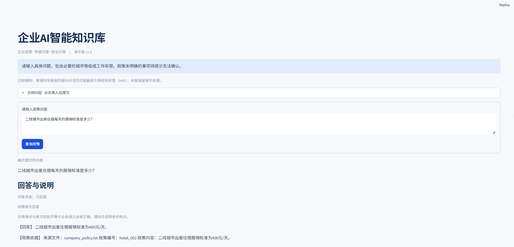
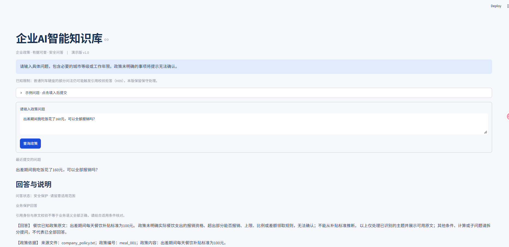
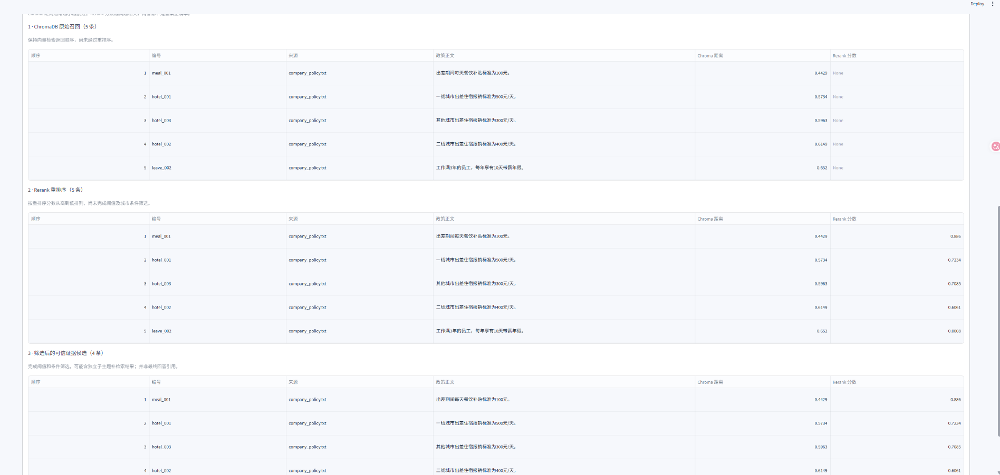

# 企业AI智能知识库 · Streamlit v1.0

面向企业内部政策查询的本地RAG演示项目。员工可查询出差住宿、餐饮补贴、交通报销及年假规定，并查看政策依据。项目重点是证据追溯、条件判断、保守回答与可复核评测，适合作为初级AI解决方案工程师的求职作品。

当前知识源为 `knowledge_base/company_policy.txt`，按固定四章节格式解析为7条政策。它是范围有限的演示系统，尚不支持任意PDF上传、多租户权限或生产部署。

## 核心功能

- 中文Streamlit页面：问题输入、示例填入、五类问答状态、政策原文卡片和默认折叠的检索详情。
- ChromaDB向量召回Top 5，BGE交叉编码器重排序，默认阈值 **0.50**。
- 有限主题与条件规则：城市档位、明确主题排除、多城市证据保护、审批前提及金额推断保护。
- 部分联合问题在缺少证据时，对明确子主题独立检索、重新评分、筛选合并；不直接放行原低分候选。
- 生成引用校验失败时丢弃模型正文；匹配有限简单问法且最终证据完整时，用Python构造真实原文回答。
- CLI、模拟单元测试及独立数据库评测入口。网页只在提交时问答，会话重绘沿用最近结果；共享资源通过锁串行执行问答。

## 技术栈与模块

| 技术/模块 | 实际职责 |
| --- | --- |
| Python（项目目标环境3.12） | 服务、规则、评测及unittest模拟测试 |
| Streamlit | 中文网页、资源缓存、会话状态、检索表格 |
| ChromaDB | 持久化向量集合 `company_policy` 的查询 |
| sentence-transformers / `BAAI/bge-reranker-base` | 候选文本对重排序 |
| Ollama / `qwen2.5:3b` | 本地回答生成 |
| `policy_loader.py` | 固定格式政策解析及元数据构造 |
| `rag_service.py` | 召回、筛选、有限补检索与问答编排 |
| `policy_evidence_guard.py` / `policy_citations.py` | 业务保护、相关性定位、引用验证与原文回退 |
| `main.py` / `app.py` | CLI / Streamlit入口 |
| `evaluate_rag.py` | 题集校验、独立评测、指标及唯一报告 |

`requirements.txt`仅列4个直接运行依赖，版本来自本地虚拟环境的包METADATA：Streamlit 1.66.0、ChromaDB 1.5.9、Ollama Python客户端0.6.3、sentence-transformers 6.1.0。这是已安装版本记录，不是全新环境兼容性验证或传递依赖锁文件；torch、transformers等由安装器解析。unittest属于标准库，不需要另装pytest。向量嵌入配置沿用Chroma集合默认行为，本项目未显式指定独立Embedding模型；迁移数据库时须核对原集合与本地资源配置。

## 系统架构

网页调用共享的 `RagService.answer_question()`。服务先处理明确主题排除，再召回、重排序及筛选，必要时补检索，随后执行必需条件检查和业务保护。安全规则可以直接返回；普通生成结果需经引用验证，失败后只允许有限原文回退。

详细分支与真实先后关系见 [系统架构](docs/architecture.md)。`retrieved`、`reranked` 是首次查询快照；`final_policies` 是筛选及补检索合并后的候选。页面引用区使用服务返回的 `policies`，不把全部候选当作已验证的最终引用。业务保护分支的 `policies` 表示规则返回的依据，不能笼统宣称其全部经过模型引用解析。

## 系统运行截图

### 1. 正常政策问答

用户询问二线城市出差住宿标准，系统回答400元/天，并展示 `hotel_002` 政策引用。



### 2. 业务安全保护

用户询问餐饮花费160元能否全部报销，系统引用每日100元餐饮补贴政策，并明确无法推断全部费用是否可以报销。



### 3. RAG三阶段检索

展示ChromaDB原始召回、BGE Rerank重排序和候选证据筛选。本次截图显示召回5条、重排序5条、筛选候选4条。**候选证据不等于最终实际引用**，分数也不等于答案正确率。



## 本地运行

### 1. Windows环境安装

以下命令供使用者在项目根目录手动执行，本轮文档整理没有执行安装、模型下载或数据库写入。先安装Python 3.12并确认Windows Python启动器可用。在新的项目工作副本中执行，不要覆盖已有虚拟环境：

```powershell
py -3.12 --version
py -3.12 -m venv .venv
.\.venv\Scripts\python.exe -m pip install -r requirements.txt
.\.venv\Scripts\python.exe -m pip check
.\.venv\Scripts\python.exe -m unittest discover -v
```

使用虚拟环境解释器完整相对路径，不依赖PowerShell激活脚本执行策略。若创建或安装步骤失败，请停止后续启动。当前未固定传递依赖、Ollama服务端版本或模型文件修订版本，新环境仍需验证。

### 2. 准备本地模型

Ollama Python包不包含Ollama服务端。请先单独安装Ollama桌面/服务端并确保命令可用，再手动准备模型：

```powershell
ollama --version
ollama pull qwen2.5:3b
ollama list
# Ollama桌面后台已运行时无需重复启动；没有后台服务时另开终端运行：
ollama serve
```

`pull`下载模型，不进行问答推理。Reranker在首次加载时可能下载 `BAAI/bge-reranker-base`，默认Chroma嵌入函数首次建库/查询也可能下载资源；离线演示前须在本机预先完成加载验证。模型缓存不随仓库发布，下载需要网络、磁盘空间及可用资源。没有运行实测，不承诺特定显存、内存或加载时长。

### 3. 准备独立示例数据库

**仓库不发布Chroma数据库副本。仅有 `company_policy.txt` 不等于数据库已经构建完成。** 网页和评测只打开已有库，不能直接拿空目录启动。

核实结果：现有 `policy_sync.py` 的CLI固定写入正式 `chroma_db`，没有 `--test-db-path` 初始化参数；`chroma_test.py`同样不是安全演示初始化入口。不要用这两个脚本准备回归测试库。

以下是手动组合已有 `load_policy_documents()` 和 `sync_policies()` API的示例命令，不是新增CLI参数。它只创建项目根目录下全新的 `rag_demo_copy`，目录已存在即停止，且显式拒绝正式库及其子目录。**此步骤尚未在全新环境执行验证**，建议在单独下载的项目工作副本中操作；失败后可能留有部分新库，不要直接重跑或改写既有库。

```powershell
$initDemo = @'
from pathlib import Path
from policy_loader import load_policy_documents
from policy_sync import sync_policies
from main import DATABASE_PATH, validate_test_database
import chromadb

documents = load_policy_documents()
target = Path('rag_demo_copy').resolve()
formal = DATABASE_PATH.resolve()
if target == formal or formal in target.parents:
    raise ValueError('Refusing formal database')
target.mkdir(exist_ok=False)
client = chromadb.PersistentClient(path=str(target))
collection = client.get_or_create_collection(name='company_policy')
print(sync_policies(collection, documents))
validate_test_database(target)
print('Independent demo database prepared')
'@
.\.venv\Scripts\python.exe -c $initDemo
```

该操作写入新建示例库，不是只读操作；没有触碰正式库的必要。它使用当前Chroma默认嵌入函数，不能宣称完全复现历史向量库或历史分数。建库进程结束后，再把这个已有独立库配置给网页；评测请使用另行准备的独立副本。

### 4. 启动网页与CLI

已完成上述准备后，在项目根目录执行：

```powershell
# 将示例路径替换为已有独立副本；不要指向正式chroma_db。
$env:POLICY_APP_TEST_DB_PATH = (Resolve-Path .\rag_demo_copy).Path
.\.venv\Scripts\python.exe -m streamlit run .\app.py --server.address 127.0.0.1 --server.port 8501
```

打开 `http://127.0.0.1:8501`。浅色主题在 `.streamlit/config.toml` 中配置，修改主题后应重启服务。实际提交普通问题可能调用本地Qwen；原文和规则分支可能跳过生成。

CLI也可显式使用已有副本：

```powershell
.\.venv\Scripts\python.exe .\main.py --test-db-path .\rag_demo_copy
```

网页与评测沿用安全路径检查：拒绝正式库及其子目录、符号链接/Windows重解析点、硬链接等不安全情况；要求既有 `chroma.sqlite3`，初始化使用 `get_collection`。不自动同步政策。`policy_sync.py` 是独立的显式写入工具，不属于演示启动流程；Chroma客户端本身也不构成数据库文件的只读保证。

## 政策引用与安全边界

模型引用编号必须属于本次候选，来源必须匹配，已提供的政策内容/原文必须完整一致；正文显式原文、额外编号和来源也会校验。当前解析器允许引用区省略政策内容，最终展示会用候选中的完整原文补齐，不能描述成“所有模型输出都必须逐字包含原文”。Python简单回退另会对照已加载政策核对内容和来源。

真实引用不代表结论正确。规则明确保护住宿实际金额、差额领取、餐饮超额报销、商务座批准后待遇、未满一年年假和年假叠加等有限场景。没有足够依据时说明无法确认；不将补贴标准推断为报销上限或实际赔付金额。

| 状态 | 页面含义 |
| --- | --- |
| `ok` | 已回答，可能来自模型校验结果或Python原文回退 |
| `guarded` | 保守说明、部分回答或安全拒答；不必然表示业务错误 |
| `needs_input` | 缺少必要条件，需要补充信息 |
| `no_policy` | 本次召回或筛选后无可用依据，不能证明公司不存在规定 |
| `error` | 服务调用失败；网页提供脱敏提示 |

## 测试与评测事实

测试记录由本地运行反馈提供：172项unittest此前通过；网页工程化新增4项后为176项，主题样式再新增2项后为178项。**根据项目维护者本地运行反馈，178项unittest已通过**。此记录并非代理环境复跑结果；代理环境的指定虚拟环境此前无法启动Python 3.12，不能把静态检查当成全量测试通过。

```powershell
.\.venv\Scripts\python.exe -m unittest discover -v
.\.venv\Scripts\python.exe -m unittest test_app -v
.\.venv\Scripts\python.exe evaluate_rag.py --cases-path eval_cases_holdout.json
```

模拟测试覆盖服务编排、冻结基线、业务保护、伪造引用、默认阈值与传递、独立数据库安全及网页重绘。最后一条只校验题集，不初始化数据库或模型。

原题集25题；原留出集24题已经用于多轮修复，当前应称为**回归集**，不能再作为完全未见过的独立泛化证据。报告 `eval_a7651e8f2fbb4de7805a6ad6c5f0b302.json` 记录阈值0.50下：

| 自动指标 | 结果 | 分母 |
| --- | --- | --- |
| Recall@5宏平均 | 100% | 20道有预期政策ID的题 |
| 最终政策召回宏平均 | 100% | 20题 |
| 全部预期政策命中率 | 100% | 20题 |
| 状态匹配率 | 100% | 12道有唯一预期状态的题 |
| 平均单次响应时间 | 约0.895秒 | 24题，不含初始化 |

这些100%是该次运行的自动指标，**不是语义准确率**。12道 `manual_review` 题不计入状态匹配分母；H09该次仍通用拒答，报告所有人工审核字段仍为pending。召回指标不惩罚额外候选；需逐项核对事实、禁止结论及实际引用。结果不构成性能承诺，也不支持“24题答案全部正确”。

真实评测必须同时提供 `--run` 和 `--test-db-path`；可选阈值0.50/0.45/0.40仅用于实验。报告记录题集路径、题集和政策哈希、实际阈值，并用UUID及排他创建避免覆盖历史报告。本轮不执行真实评测。

## 已知限制与求职展示

- H09普通列车硬座问法偶发引用格式拒答；当前未修复，演示应如实说明。
- 主题规则和回退语法有限；复杂否定、条件组合及口语表达可能不覆盖。多城市即便证据齐全也保守返回guarded。
- 只有7条结构化政策，不等同于大规模企业知识库；尚无身份认证、权限隔离、监控或生产SLA。
- 依赖本地Python、Ollama、模型缓存及既有向量库；首次加载耗时与报告中的单次问答耗时不同。

面向深圳、广州初级AI解决方案工程师岗位，可围绕“业务需求拆解→RAG流程→可追溯引用→风险保护→评测与界面交付”介绍本项目。仅陈述自己实际完成、能现场解释的工作，不包装为企业生产上线项目或声称不存在的客户收益。

文档入口：[3分钟演示脚本](docs/demo_script.md)、[网页启动说明](WEB_DEMO.md)、[回归集说明](HOLDOUT_EVALUATION.md)。真实运行截图见上方“系统运行截图”，图片位于 `docs/images/`。

公开仓库前请人工检查：原始报告含本机绝对路径，默认忽略；已被Git跟踪的文件不会因 `.gitignore` 自动移除。对外引用报告应另制作脱敏样例，保留原指标和审核状态，不修改历史原件。

`chroma_test.py` 是早期学习脚本，执行或导入会初始化集合、可能写入本地数据库并进入交互循环，不是当前安全演示入口；不要把它作为单元测试或启动命令执行。示例知识库及代码、题集中重复的政策文字，其来源和公开授权仍需维护者人工确认；本文不替代资料授权审查。
