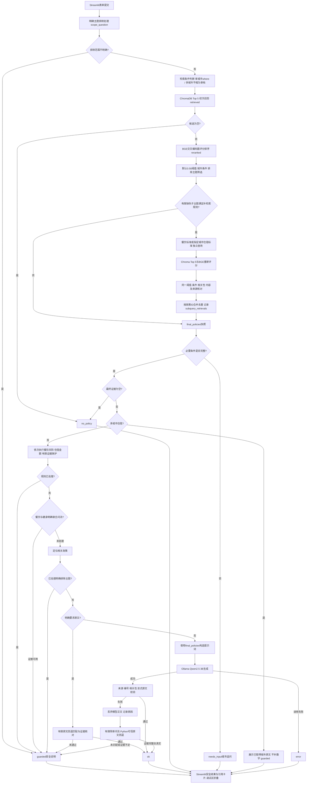

# 系统架构与执行顺序

以下对应 `RagService.answer_question()` 当前实现，不代表通用RAG框架。网页先安全校验已有独立数据库路径、加载缓存资源，再在表单提交时调用服务；会话重绘只显示最近结果。

## 关键分支

必要城市缺失检查在初次检索、筛选及有限补检索之后执行。检索前的城市解析用于构造where，不能把它画成“缺城市立即追问”。多城市路径跳过单城市必需条件检查，当前总是保守展示已获得的城市原文，不承诺完整回答。

补检索仅覆盖已实现的两类条件：明确餐饮与另一支持主题联合且缺少餐饮候选；明确单城市住宿差额/余款等且缺少住宿候选。初次召回为空会提前返回，不进入补检索。补检索不查询固定政策编号、不使用用户金额计算实际赔付，每次独立评分仍须达到当前阈值。

保护分支及明确原文分支可以跳过Qwen。生成路径先生成再验证；失败才尝试有限回退。图中的Python规则回答不经过模型引用解析，不应被描述为所有分支都先生成或先验证。模型校验支持省略引用区原文，但显式提供的原文必须一致，最终统一展示候选完整原文。

## 数据和资源边界

| 字段/资源 | 含义 |
| --- | --- |
| `retrieved` | 首次Top 5召回顺序与距离，补检索不会改写它 |
| `reranked` | 首次BGE评分及排序，不等同于最终回答依据 |
| `final_policies` | 过滤及补检索合并后的候选，可能含无关高分记录 |
| `policies` | 服务随安全输出返回的依据；页面引用卡片只取此字段 |
| `subquery_retrievals` | 每次补检索的查询、召回、评分、接纳快照；网页目前显示数量摘要 |
| `diagnostics` | 引用失败原因、是否丢弃模型正文、部分回答来源；不是语义正确性认证 |

业务保护仍是有限规则。旧住宿金额分支会将最终候选列表作为返回依据，不能声称所有规则分支均有统一、全面的语义引用过滤。网页隐藏已知本地路径形态和异常详情，不替代发布前的人工脱敏审查。

`get_resources()` 使用Streamlit资源缓存；`SharedService`用锁串行保护共享问答。`validate_test_database()`检查副本安全性，`get_collection()`仅打开已有集合；政策写入由独立 `policy_sync.py` 管理，演示入口不自动调用。无多租户认证或生产权限系统。
