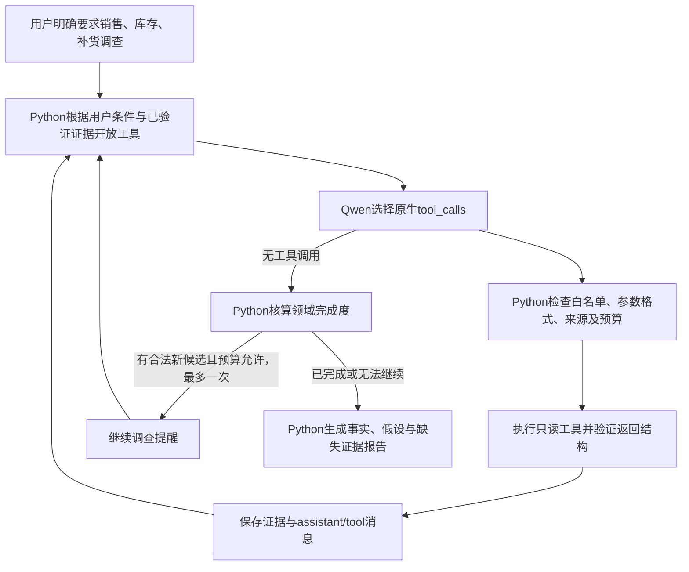

# 项目案例：虚构深圳服装店经营诊断Agent

本案例用于深圳、广州初级AI应用工程师、AI解决方案工程师求职展示。店铺、经营数据、单据、时间和库存全部虚构，不对应真实客户，不连接企业系统。仓库实现和本地验证不能包装为生产部署或客户收益。

## 业务问题与事实口径

虚构店铺SZ-DEMO-001最近营业额下降，老板提出：“最近营业额为什么下降？帮我调查销售、库存和补货环节。”系统要先查询数据，再区分事实、假设和待补证据，而不是让模型直接猜原因。

销售口径为两个完整7日：P1是2026-09-01至09-07，P2是09-08至09-14；起点包含、终点不包含，时区+08:00。客流为进店人次，订单为完成成交单，演示不涉及退款；金额源数据使用整数分。

| 已确认指标 | P1 | P2 | 变化 |
| --- | ---: | ---: | ---: |
| 客流（人次） | 2100 | 2100 | 0 |
| 订单（单） | 630 | 490 | -140 |
| 成交率 | 30% | 23.3333% | -6.6667个百分点 |
| 客单价（元） | 300 | 286 | -14 |
| 营业额（元） | 189000 | 140140 | -48860，约-25.8519% |

成交率=订单/客流，营业额=订单×客单价。百分数四舍五入至4位小数；“百分点变化”与“相对百分比降幅”不同。上述计算能够说明营业额与订单、客单价的变化关系，但不能证明顾客为什么没有成交。

## 证据链及工具分工

| 证据 | 由哪个工具取得 | 能确认的事实 |
| --- | --- | --- |
| SALE-P1、SALE-P2 | query_sales | 两个期间的销售及计算依据 |
| CAT-001 | query_sales | P1基础T恤销量180件；允许进一步调查此商品，不自动提供颜色尺码 |
| REP-001 | query_replenishment | 基础T恤补货申请、审批、采购、预计/实际到货及白色M/L规格 |
| INV-002 | query_inventory | 2026-09-14 20:00基础T恤白色M码库存0件，记录缺货起点9月9日10:00 |

REP-001显示：9月8日10:00申请，9月11日10:00审批，9月12日10:00采购，预计9月12日10:00到货，实际9月16日10:00到货。审批等待3天、晚到4天；白色M码到货30件、L码20件。这些是时间差事实，不等于已经判断某个员工失职或审批违反制度。

**历史库存不能与后续到货混算。** INV-002观察时间为9月14日，9月16日到货尚未发生；不能将30件加回9月14日库存，也不能据此断言9月18日当前库存仍是0。补货资料截至9月18日，但本项目没有9月18日实时库存流水。

## 模型如何调查，Python如何把关

维护者已确认本地Qwen2.5:3b通过Ollama原生Function Calling完成销售→补货→历史库存的三工具链路。这是已验证路径，不是Python写死的执行顺序，也不承诺所有运行都会选择同一SKU。



图展示主路径。实际代码还会处理多调用批次：整批不执行，再进行一次计入预算的串行重新选择；非法参数、未知或未开放工具、重复调用等也会安全停止并保留部分结果。

三个确定性工具使用同一套数据、Pydantic参数/响应模型和证据标识；Agent不通过RAG猜库存，不解析正文JSON冒充原生工具调用，不提供审批或库存写入能力。

本次业务链路的许可关系是：

1. 初始没有商品规格依据，只开放固定单店P1/P2的销售工具。
2. query_sales验证成功后，CAT-001中的商品允许开放补货查询。模型实际传入的商品仍要核对，工具开放不等于任意参数都能执行。
3. query_replenishment取得REP-001后，其同一商品同一补货项的白色M码允许开放历史库存查询。禁止从不同商品或不同记录拼接规格。
4. Python执行query_inventory并验证INV-002，数值和时间来自工具，不来自模型描述。

每次chat前重新计算工具列表，用户若已明确提供合法完整规格，也可以直接查询库存。默认边界为最多6次模型请求、5次工具尝试、90秒任务等待；模型仍能在合法候选中选择并结束。

## 提前结束与完成度提醒

真实调试中，模型曾取得销售和补货证据后返回no_tool_calls，即使合法库存候选已经开放。此前系统如实返回partial，而不是谎称完成。

当前代码按用户明确要求的领域和verified结果核算完成度：销售要有可信期间比较，补货要有流程记录，库存要有真实规格结果，数量0也算查询事实。模型自称“查完了”不计数。

如果模型提前结束、库存仍缺失，且REP-001已经支持尚未执行的库存候选，Python最多追加一次提醒，指出缺失领域和合法工具名。提醒不执行工具、不补参数，后续请求仍需独立校验，且计入原预算。用户只查销售或补货时不会被强制扩展为三领域调查。

一次提醒为模型提供继续完成当前调查的机会，维护者已报告当前版本三工具链路成功。本案例不捏造逐轮日志或声称提醒在所有运行中都会成功；如再次结束、参数错误或预算不足，仍保留partial/stopped及已确认事实。

## 给老板的分析应该如何表述

**已确认事实：** 客流保持2100，订单减少140，客单价下降14元；营业额从189000元降至140140元。基础T恤白色M码在9月14日快照为0，补货实际到货比预计晚4天。

**未证实假设：** 热销规格缺码可能影响部分成交，晚到可能延长缺货；但现有证据不能证明缺码造成营业额下降，也不能量化缺码导致多少销售损失。客单价变化还可能涉及商品结构、价格或促销，需要数据核实。

**还需要补充的数据：** 每日SKU销量与库存流水、实际验收及上架时间、试穿未成交和缺码需求记录、价格及促销、顾客流失原因。这些数据本项目没有，不由模型编造。

最终数值报告由Python模板生成，严格使用工具结果。模型承担选工具任务，程序承担许可、证据和展示边界，不采用模型编造的销售额或确定性因果结论。

## 最难的一次真实调试

最有代表性的故障是：用户明确说“请查询基础T恤的补货记录，检查补货申请、审批和到货时间是否存在延迟”，模型也正确传入基础T恤及店铺，但来源核对仍拒绝。

排查没有直接删除安全规则，而是先增加仅trace展示的阶段、必要参数和逐字段来源诊断。结果发现Pydantic与店铺范围均正确，真正问题是整句正则不接受后面的调查说明，导致商品识别为空。随后只扩展有限合法说明语法，并补充否定、改口、多商品和错误商品测试。

之后又遇到批量空参数调用与提前结束：分别通过一次串行重选、证据驱动的动态工具开放、按真实结果核算完成度和一次继续提醒处理。核心经验是把“模型格式错误、参数无来源、任务未完成”分开诊断，而不是通过放宽校验掩盖问题。

## 验证证据与运行方式

维护者报告：Windows Python 3.12环境351项自动化测试全部通过，耗时1.217秒。这是全项目离线测试运行时间，**不是Agent推理耗时或性能基准**。另有本地Qwen2.5:3b原生三工具链路成功反馈；Fake测试与真实模型验证是两类证据，前者不能替代后者的稳定性评估。

本轮案例整理不安装依赖、不调用模型。使用者在项目根目录手动运行：

```powershell
# 离线测试，不连接模型或数据库
.\.venv\Scripts\python.exe -m unittest demos.store_diagnosis.test_data demos.store_diagnosis.test_tools demos.store_diagnosis.test_agent demos.store_diagnosis.test_availability demos.store_diagnosis.test_progress demos.store_diagnosis.test_diagnostics -v
.\.venv\Scripts\python.exe -m unittest discover -v
# 已准备好Ollama和本地模型后才执行真实推理
.\.venv\Scripts\python.exe -m demos.store_diagnosis.cli '最近营业额为什么下降？帮我调查销售、库存和补货环节。' --trace
```

完整参数与限制见[模块README](../demos/store_diagnosis/README.md)，整体环境、RAG和API见[根README](../README.md)。两个服装demo彼此独立，不能将单工具助手的8件混作本案例的历史库存。

## 面试展示材料

### 约1分钟项目介绍

“我在原有企业RAG与FastAPI项目之外，做了一个完全虚构的服装店经营诊断Agent。业务问题是客流稳定但营业额下降。我先设计口径一致的销售、库存和补货数据，再做三个只读工具，让Qwen通过原生工具调用逐步调查。Python负责参数验证和来源追踪，例如销售结果里的商品支持补货查询，补货记录里的规格才支持库存查询。我遇到过合法问题被正则误拒、模型批量填空参数和提前结束，分别加入阶段诊断、动态开放工具及一次有界提醒。最后用Python事实报告区分事实和假设，避免把历史缺货直接说成销售下降原因。维护者本地全项目351项测试通过，也验证了真实三工具链路；它仍是本地学习原型，不是生产客户系统。”

### 技术架构与业务价值

- 架构：Python 3.12＋Pydantic v2＋Ollama/Qwen2.5:3b＋标准库unittest；原始数据、工具、来源许可、可用性、完成度和CLI分层，无大型Agent框架。
- 业务问题：把“为什么下降”拆为可查询的销售指标、历史缺码与补货时间线，给出可审查事实及下一步取数清单，而非猜测式结论。
- 可展示能力：需求拆解、数据口径设计、模型与确定性代码分工、失败定位、离线测试及真实模型回归。使用Codex辅助实现，面试中应能独立解释关键函数和验证依据。

### 局限与下一步

中文条件和领域识别是有限规则；完成度仅代表领域至少有一次可信结果；模型仍可能提前结束或选错参数。尚无全新环境复现证明、生产部署、鉴权、并发治理或压力测试；90秒等待截止也不保证取消底层生成。

下一步可优先整理更多复杂表达正反例、记录多次真实模型的工具选择与失败类型、固定可复现依赖和模型版本，再评估任务取消与进程隔离。接真实业务前还需数据授权、权限和只读接口审查，本项目不提供这些已完成的承诺。
